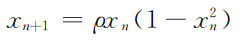
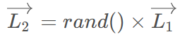
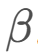
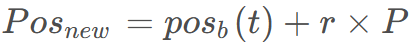
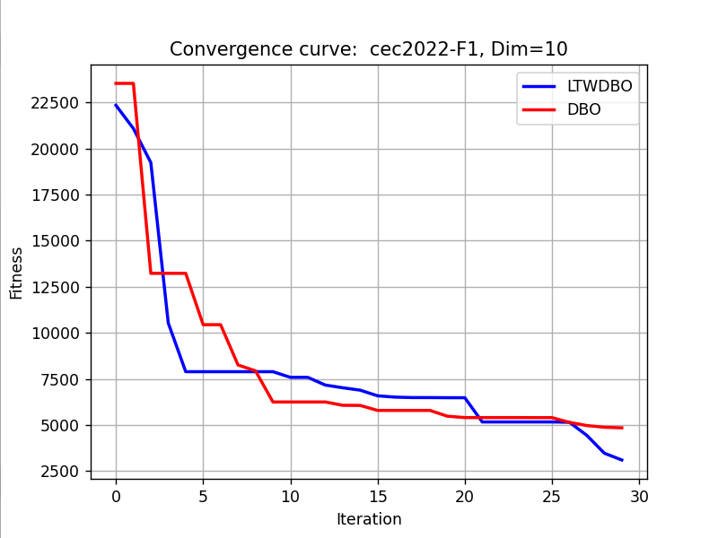
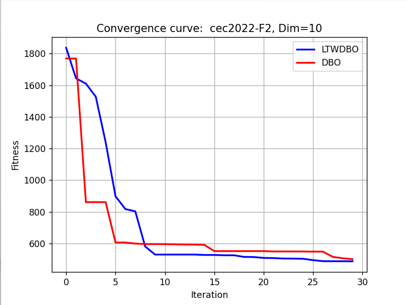

# Improved Dung Beetle Python (Triangle Swimming + Levitating Flight)

Today, we bring you an improved version of the Dung Beetle optimization algorithm. A previous article introduced an improved sinusoidal algorithm-guided ant optimization algorithm (MSADBO), but that article has already been published.
The improvements introduced today are entirely personal and should not be found on the internet. They can serve as a reference for everyone, and you can continue to improve upon them based on the author's work.
The improvement strategy is as follows:
1. The Cubic chaotic mapping is adopted, the formula is as follows:
The use of a cubic mapping to increase particle diversity can reduce the time required for particle optimization, and enhance the convergence speed of the algorithm. For those wishing to improve their algorithms using other chaotic mappings, refer to this article: "10 Chaotic Mappings for Optimizing Grey Wolf Algorithms: A One-Click Switch, Suitable for Optimizing All Particle Swarm Optimization Algorithms."
② Utilize the triangle roaming strategy.
Improvements made during the foraging phase of the Dung Beetle beetle, allowing it to move around the food without directly approaching it, increasing randomness. The formula for the triangle-walking strategy is as follows:
Subsequently, the direction of walking is defined according to the following formula.
The following formula is used to calculate the position obtained by the Dung Beetle after it has moved.
③Levy flight and greedy strategy
Levy flight is a highly effective method for providing random factors. Levy flights can provide stochastic walk methods with step lengths that follow the Levy distribution. However, Levy flights sometimes have excessively long steps, so by multiplying Levy flights by a constant C, we can reduce the step size. The formula for the Levy flight walk strategy is as follows.
After the levy flight mechanism is completed, a greedy strategy is adopted. If the fitness of a particle is less than that of its predecessor, it will replace the particle.
The required packages are:
matplotlib~=3.8.2\nnumpy~=1.26.3\nscipy~=1.12.0\nopfunu~=1.0.1\nResults Display
Utilizing the powerful opfunu library in Python, it integrates 11 CEC function libraries such as CEC2005/2008/2010/2013.

## Images

<!-- PAYMENT_BLOCK -->

## Get this dataset

- Payment link (Stripe): [Buy now](https://buy.stripe.com/3cs8yP7sY87d0vu9AB)
- Payment QR code: 

<!-- /PAYMENT_BLOCK -->
